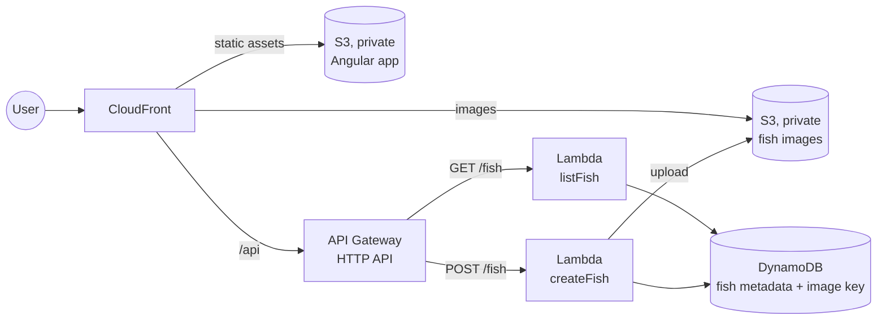

# chunkaichen

Personal portfolio website, built to learn Angular, TypeScript on AWS Lambda, and AWS.

## Pages

| Tab | Type |
| --- | --- |
| About Me | Static |
| Experience | Static |
| Contact | Static |
| Hobbies | Static |
| Aquarium | Dynamic: visitors upload a photo of a fish they caught, and it swims around the screen. Fish persist. |

## Architecture

- **Frontend:** Angular, hosted in S3
- **Backend:** TypeScript (Node.js) Lambda functions behind API Gateway (HTTP API), one per endpoint. The functions run outside a VPC and reach S3 and DynamoDB through IAM permissions.
- **Storage:** Fish images go in S3. DynamoDB holds each fish's metadata plus its S3 object key (not a full URL).
- **CDN:** CloudFront is the only intended way in, for static assets, images and the API (`GET` and `POST`). The Angular app calls the API through relative `/api/...` paths on the same domain, so its traffic always goes through CloudFront. A CloudFront behavior routes `/api/*` to API Gateway. API Gateway's public `execute-api` URL is left open, since direct access is acceptable. Both S3 buckets are private and readable only by CloudFront. Images are cached indefinitely, since fish can't be modified. The cached `GET /fish` response is refreshed whenever a new fish is added.
- **Aquarium:** Each fish is a PNG bouncing around the screen. `GET /fish` returns all fish in one response.
- **Deployment:** AWS SAM. One template defines the functions, API Gateway and their permissions, and `sam deploy` ships them. `createFish` needs a timeout above the 3-second default, and the `cloudfront:CreateInvalidation` permission to refresh the cached `GET /fish` after each upload.
- **Debugging:** CloudWatch Logs

### Upload flow

The browser compresses the image to a target size before uploading. The image then goes through CloudFront and API Gateway to the `createFish` Lambda, so all errors are handled in one place on the backend. Lambda caps request payloads at 6 MB, so the function also enforces its own maximum size (the browser compression can be bypassed).

1. The Lambda writes the fish to DynamoDB with the default image key, pointing to a default fish image in S3. If that fails, it returns an error.
2. The Lambda uploads the image to S3. If that succeeds, it updates the fish's image key to the uploaded object.

If the upload fails or the function times out partway through, the fish keeps the default image. Metadata shows on hover, so the uploader can still find their fish.

## Learning choices

Parts of this design are deliberately more involved than a portfolio site needs. The simpler alternatives:

| Learning choice | Simpler alternative |
| --- | --- |
| Uploads go through the backend | S3 presigned URLs: the browser uploads directly to S3, with no 6 MB payload limit |
| API Gateway in front of Lambda | Lambda function URLs as CloudFront origins, if routing, throttling and auth aren't needed |

The original design (Spring Boot on two EC2 instances across two AZs, behind an internet-facing ELB in a VPC with gateway endpoints) is in this README's git history.

## Future work

- **Image quality:** check whether browser compression makes fish look bad in the aquarium, and tune the target size
- **Fish modification and deletion:** needs an auth model (admin, uploader) and cache invalidation
- **Pagination and virtual scrolling:** newest-first, cursor-based pages (`GET /fish?before=<createdAt>&limit=N`), with DynamoDB partition key `FISH` and sort key `createdAt#fishId`. Pages with a cursor are cached forever, and only page 1 is refreshed. The tab renders fixed-height blocks of fish, unrenders blocks out of view, and lazily fetches the next block.
- **Moderation:** AWS Rekognition to screen uploaded images.
- **AWS WAF:** body-size and per-IP rate-limit rules at the edge, to stop oversized or spam uploads before they reach the backend
