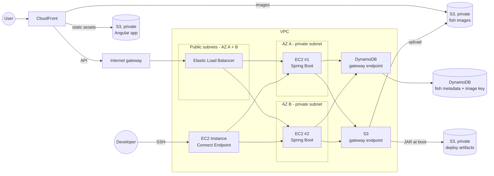

# chunkaichen

Personal portfolio website, built to learn Angular, Spring Boot and AWS.

## Pages

| Tab | Type |
| --- | --- |
| About Me | Static |
| Experience | Static |
| Contact | Static |
| Hobbies | Static |
| Aquarium | Dynamic: visitors upload a photo of a fish they caught, and it swims around the screen. Fish persist. |

## Architecture

- **Frontend:** Angular, hosted in S3
- **Backend:** Spring Boot on two EC2 instances behind an internet-facing ELB in public subnets (one per AZ). The ELB only accepts CloudFront traffic: its security group allows only the CloudFront managed prefix list, and it requires a secret header that CloudFront adds. EC2 is used instead of Lambda on purpose, to learn it. The instances are in private subnets, one per AZ across two AZs, with no auto scaling, and reach DynamoDB and S3 through VPC gateway endpoints (no NAT gateway).
- **Storage:** Fish images go in S3. DynamoDB holds each fish's metadata plus its S3 object key (not a full URL).
- **CDN:** CloudFront is the only way in, for static assets, images and the API (`GET` and `POST`). Both S3 buckets are private and readable only by CloudFront. Images are cached indefinitely, since fish can't be modified. The cached `GET /fish` response is refreshed whenever a new fish is added.
- **Aquarium:** Each fish is a PNG bouncing around the screen. `GET /fish` returns all fish in one response.
- **Deployment:** The Spring Boot JAR is uploaded to an S3 artifacts bucket. On boot, each instance's user-data script downloads it through the S3 gateway endpoint and runs it.
- **Access:** Shell access to the private instances goes through an EC2 Instance Connect Endpoint (no bastion host).

### Upload flow

The browser compresses the image to a target size before uploading. The image then streams through CloudFront and the ELB to EC2, so all errors are handled in one place on the backend. Spring Boot enforces a maximum upload size (multipart limits), because the browser compression can be bypassed.

1. EC2 writes the fish to DynamoDB with the default image key, pointing to a default fish image in S3. If that fails, it returns an error.
2. EC2 uploads the image to S3. If that succeeds, EC2 updates the fish's image key to the uploaded object.

If the upload fails or the instance crashes partway through, the fish keeps the default image. Metadata shows on hover, so the uploader can still find their fish.

## Learning choices

Parts of this design are deliberately more involved than a portfolio site needs, to get hands-on with core AWS building blocks. The simpler alternatives:

| Learning choice | Simpler alternative |
| --- | --- |
| Spring Boot on EC2 | Lambda (behind API Gateway or a function URL): no servers, pay per request, free tier covers this traffic |
| Two instances across two AZs | One small instance, or Lambda, which is multi-AZ by default |
| Internet-facing ELB in public subnets, locked down to CloudFront | Internal ELB reached through CloudFront VPC origins: no public subnets, internet gateway, prefix list or secret header |
| ELB for load balancing | CloudFront origin groups give primary/secondary failover between origins, but not true load balancing. Lambda removes the need for either. |
| VPC, private subnets, gateway endpoints | Lambda outside a VPC calls S3 and DynamoDB directly, with no networking to manage |
| Uploads streamed through the backend | S3 presigned URLs: the browser uploads directly to S3 |
| JAR pulled from S3 by a user-data script | Custom AMI, a container on ECS Fargate or App Runner, or a Lambda deploy from CI/CD |
| EC2 Instance Connect Endpoint for debugging | CloudWatch Logs only (no shell needed with Lambda) |

## Future work

- **Fish modification and deletion:** needs an auth model (admin, uploader) and cache invalidation
- **Pagination and virtual scrolling:** newest-first, cursor-based pages (`GET /fish?before=<createdAt>&limit=N`), with DynamoDB partition key `FISH` and sort key `createdAt#fishId`. Pages with a cursor are cached forever, and only page 1 is refreshed. The tab renders fixed-height blocks of fish, unrenders blocks out of view, and lazily fetches the next block.
- **Moderation:** AWS Rekognition to screen uploaded images. Rekognition has no gateway endpoint, so the private instances will need an interface endpoint (about $7/month) or a NAT gateway to call it.

- **AWS WAF:** body-size and per-IP rate-limit rules at the edge, to stop oversized or spam uploads before they reach the backend
